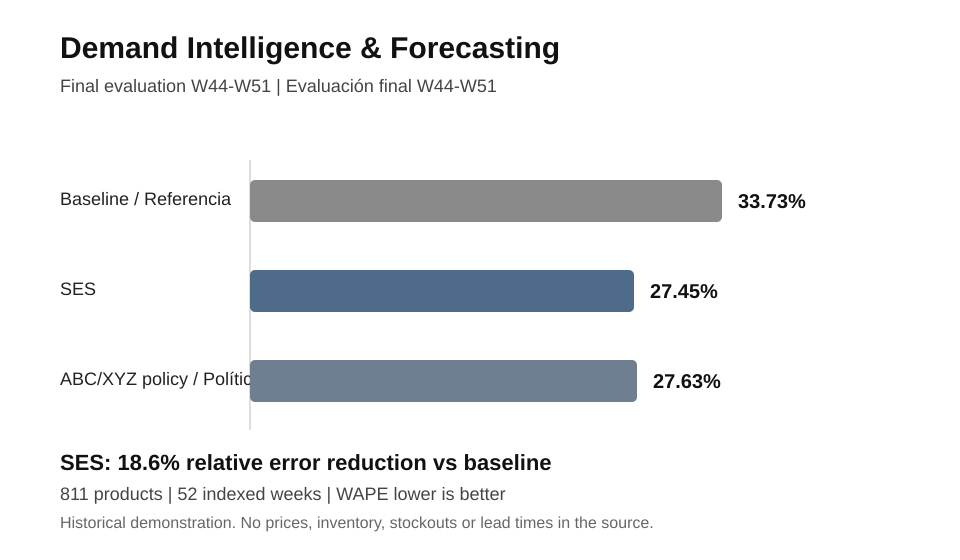

# Demand forecasting commercial sample | Muestra comercial de pronóstico de demanda

## English

**Supports:** F04 Demand forecasting, U17 Baseline forecast, U18 Multi-series forecasting.

A planning team needs a forecast it can explain and a way to compare methods under the same historical evaluation. This sample uses the public UCI Sales Transactions Weekly dataset with 811 products and 52 indexed weeks.

In the final W44 to W51 evaluation, repeating the last observed week produced a WAPE of **33.73%**. Simple exponential smoothing produced **27.45%**, an **18.6% relative reduction in total absolute quantity error** versus the baseline. A segmented ABC/XYZ model-selection policy produced **27.63%**, so the additional selection complexity did not improve the aggregate result in this evaluation.

**Example deliverable:** model comparison, product-level forecast file, WAPE and bias review, and a concise interpretation of which method should be used as the operational starting point.

**Main limit:** the source contains indexed purchase quantities, not prices, inventory, stockouts, lead times or verified unconstrained demand. These results do not establish permanent model superiority.

**Source:** Tan, J. (2014), Sales Transactions Weekly, UCI Machine Learning Repository, DOI 10.24432/C5XS4Q, CC BY 4.0.

## Español

**Respalda:** F04 Pronóstico de demanda, U17 Pronóstico base, U18 Pronóstico multiserie.

Un equipo de planeación necesita un pronóstico explicable y una comparación justa entre métodos. Esta muestra utiliza el conjunto público Sales Transactions Weekly de UCI, con 811 productos y 52 semanas indexadas.

En la evaluación final W44 a W51, repetir la última semana observada obtuvo un WAPE de **33.73 %**. El suavizamiento exponencial simple obtuvo **27.45 %**, una **reducción relativa de 18.6 % en el error absoluto total de cantidades** frente al modelo base. La política de selección por segmentos ABC/XYZ obtuvo **27.63 %**, por lo que la complejidad adicional no mejoró el resultado agregado en esta evaluación.

**Ejemplo de entrega:** comparación de modelos, archivo de pronósticos por producto, revisión de WAPE y sesgo, e interpretación breve del método que conviene usar como punto de partida operativo.

**Límite principal:** la fuente contiene cantidades compradas e indexadas. No contiene precios, inventario, desabastos, tiempos de entrega ni demanda no restringida verificada. Los resultados no demuestran superioridad permanente de un modelo.

**Fuente:** Tan, J. (2014), Sales Transactions Weekly, UCI Machine Learning Repository, DOI 10.24432/C5XS4Q, CC BY 4.0.

Carlos Segura
